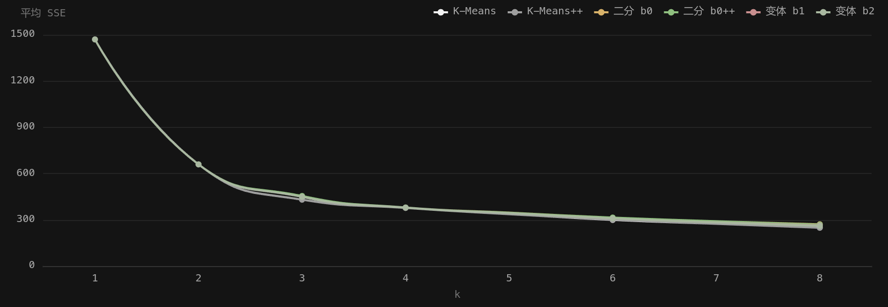
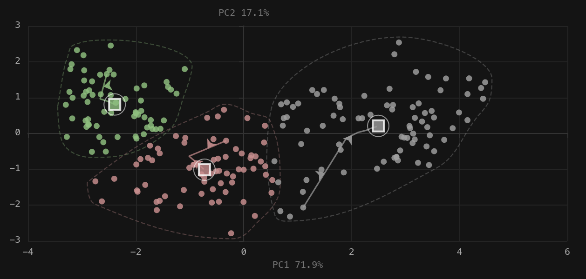
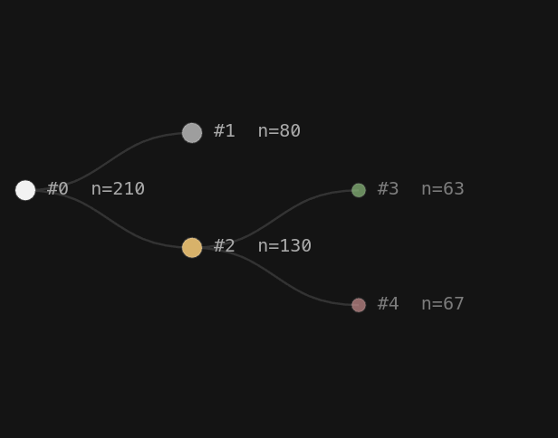
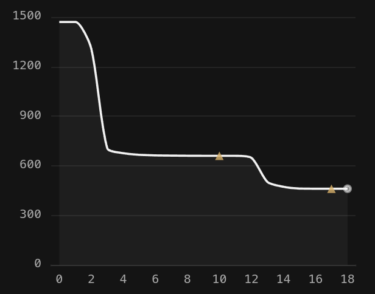
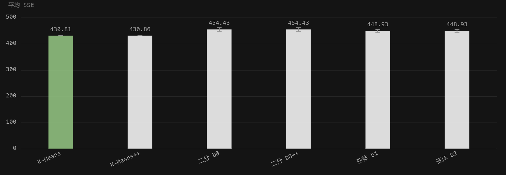

# KMeansLab 实验报告

**标准 K-Means、二分 K-Means 及其改进** · Python 3.11 / NumPy / ECharts

## 摘要

本实验实现标准 K-Means、二分 K-Means 与改进二分 K-Means，在 UCI Seeds 和 Wine 上以 20 个随机种子比较聚类质量、标签一致性和运行开销，并记录每一次分裂与迭代帧序列。实现了三项改进：K-Means++ 初始化、多次初始化择优、按全局 SSE 降幅选择分裂簇。实验表明，三项改进在固定 K 下的收益与数据、K 值均有关。

## 1　实验目的

1. 用 NumPy 实现标准 K-Means 与二分 K-Means，输出可复现的聚类结果。
2. 记录分裂过程与内层迭代。
3. 对二分 K-Means 提出三项改进，并通过消融实验量化各改进的作用。

## 2　数据集与预处理

| 数据 | 样本数 | 特征数 | 类别数 | 用途 |
|:--|--:|--:|--:|:--|
| [UCI Seeds](https://doi.org/10.24432/C5H30K) | 210 | 7 | 3 | 低维主实验，比较分裂过程 |
| [UCI Wine](https://doi.org/10.24432/C5PC7J) | 178 | 13 | 3 | 高维验证 |
| 人造二维数据 | 150 | 2 | 3 | 直观展示簇的分裂顺序 |
| 重复点样本 | 7 | 2 | — | 检验重复点、空簇与 K 接近 N |

数据保留原始样本顺序。训练特征按总体标准差（`ddof=0`）做 Z-score，常量列置零。

降维使用 NumPy SVD 实现 PCA，对标准化矩阵一次分解，样本与各帧中心共用同一投影基底。聚类与 SSE 始终在完整特征空间计算。两个主成分在 Seeds 上解释 88.98% 的方差，在 Wine 上为 55.41%。

## 3　标准 K-Means

目标函数为

<div class="formula">J = Σ<sub>k</sub> Σ<sub>i∈Ck</sub> ‖x<sub>i</sub> − μ<sub>k</sub>‖²</div>

算法交替执行两步：把每个样本分配给最近的中心；用簇内均值更新中心。收敛条件为中心最大位移不超过 `tol`，或分配结果不再变化；同时设置 `max_iter` 上限。

实现细节：

- 距离平局时取编号最小的中心，保证结果确定。
- 出现空簇时，从仍可让出样本的簇中迁移残差最大的样本，保证每个簇非空。
- 初始中心按行索引采样，重复坐标不会被合并。
- `fit` 与 `fit_steps` 共用同一迭代函数，后者额外记录每一轮状态。

## 4　二分 K-Means

全体样本先构成根簇，每轮选择一个叶簇做 K=2 的 Lloyd 迭代，直到叶簇数达到 K。基线版本（B0）选择当前 SSE 最大的叶簇进行分裂。

过程记录包含六类事件：

| 事件 | 含义 |
|:--|:--|
| `initial` | 初始整簇状态 |
| `split_selected` | 本轮选中的父簇、候选统计 |
| `split_initial` | 子簇初始中心与初始分配 |
| `iteration` | 内层迭代的每一轮 |
| `split_complete` | 分裂完成后的全局状态 |
| `converged` | 达到目标 K，运行结束 |

每一帧保存全样本标签、中心、簇编号、全局 SSE 与分裂树快照。分裂树使用稳定编号：父簇编号保留在树中，两个子簇取新编号。

## 5　改进方法

三项改进分别针对初始化、单次分裂的局部最优与分裂顺序的选择。

### 5.1　K-Means++ 初始化

子簇的初始中心按到已选中心距离平方加权的概率采样：

<div class="formula">P(x) = D(x)² / Σ<sub>x′</sub> D(x′)²</div>

初始中心因此相互分散，减少因初始点聚集导致的较差局部最优。

### 5.2　多次初始化择优

每个候选簇独立执行 r 次 K=2 拟合（默认 r=5），保留 SSE 最低的一组：

<div class="formula">SSE* = min<sub>t=1..r</sub> SSE(K=2, seed<sub>t</sub>)</div>

每次尝试的种子由 `SeedSequence(seed, spawn_key=(轮次, 簇号))` 派生，可复现。

### 5.3　按全局 SSE 降幅选择分裂簇

不再只分裂 SSE 最大的簇，而是对所有可分裂叶簇各试算一次，选择使整体目标下降最多的方案：

<div class="formula">ΔJ = J(C) − [ J(C<sub>1</sub>) + J(C<sub>2</sub>) ]</div>

### 5.4　消融设计

| 版本 | 初始化 | 每个候选重启 | 选簇依据 |
|:--|:--|--:|:--|
| B0 | 随机取点 | 1 | 最大簇 SSE |
| B0++ | K-Means++ | 1 | 最大簇 SSE |
| B1 | K-Means++ | 5 | 最大簇 SSE |
| B2 | K-Means++ | 5 | 最大 SSE 降幅 ΔJ |

B0→B0++ 检验初始化，B0++→B1 检验重启，B1→B2 检验选簇策略。标准 K-Means 的随机与 K-Means++ 两种初始化也纳入同一组对比。

## 6　实验方案

固定 `max_iter=100`、`tol=1e-6`，K=3，使用 20 个连续种子 42–61。六种配置在同一批种子上配对运行，另以相同种子扫描 K=1–8。

评价指标：

- **SSE**：簇内平方误差和，同一数据、同一 K 下比较。
- **轮廓系数**：使用全特征欧氏距离，K=1 或 K=N 时不计算。
- **ARI**：与真实类别比较，不受簇编号重排影响。
- **运行耗时、迭代次数、候选评估次数**：衡量改进的计算代价。

SSE 报告均值与总体标准差。耗时只统计算法拟合，不含 PCA、绘图与指标计算。


## 7　结果与分析

### 7.1　20 个种子的对比

**Seeds（K=3）**

| 算法 | 平均 SSE | 标准差 | 最佳 SSE | ARI | 轮廓系数 | 耗时 ms | 迭代数 |
|:--|--:|--:|--:|--:|--:|--:|--:|
| 标准随机 | 430.81 | 0.19 | 430.66 | .7800 | .4019 | 0.85 | 8.05 |
| 标准 ++ | 430.86 | 0.22 | 430.66 | .7799 | .4023 | 0.85 | 7.20 |
| B0 | 454.43 | 6.84 | 446.87 | .7479 | .3865 | 1.43 | 11.55 |
| B0++ | 454.43 | 6.84 | 446.87 | .7479 | .3865 | 1.78 | 10.20 |
| B1 | 448.93 | 4.91 | 446.87 | .7419 | .3910 | 5.85 | 9.50 |
| B2 | 448.93 | 4.91 | 446.87 | .7419 | .3910 | 8.28 | 9.50 |

**Wine（K=3）**

| 算法 | 平均 SSE | 标准差 | 最佳 SSE | ARI | 轮廓系数 | 耗时 ms | 迭代数 |
|:--|--:|--:|--:|--:|--:|--:|--:|
| 标准随机 | 1310.45 | 92.85 | 1277.93 | .8274 | .2748 | 1.50 | 6.05 |
| 标准 ++ | 1294.05 | 67.03 | 1277.93 | .8666 | .2833 | 1.65 | 5.50 |
| B0 | 1342.80 | 24.88 | 1302.21 | .6492 | .2514 | 2.45 | 9.80 |
| B0++ | 1342.48 | 19.55 | 1315.67 | .6453 | .2520 | 2.12 | 8.85 |
| B1 | 1329.28 | 24.10 | 1315.67 | .6787 | .2600 | 6.94 | 8.55 |
| B2 | 1329.28 | 24.10 | 1315.67 | .6787 | .2600 | 9.83 | 8.55 |

分析：

1. 在 K=3 时，标准 K-Means 的平均 SSE 低于两种二分算法。二分算法的叶簇在分裂后不再参与重新分配，因此最终目标值偏高；其价值在于层次结构与可解释的分裂过程。
2. K-Means++ 在 Wine 上把标准 K-Means 的平均 SSE 从 1310.45 降到 1294.05，标准差从 92.85 降到 67.03；在 Seeds 上 SSE 基本持平，平均迭代数由 8.05 降到 7.20。
3. 多次重启使二分算法的平均 SSE 在 Seeds 上降低 5.50，在 Wine 上降低 13.20，代价是耗时增加约 3 倍。
4. 在 K=3 时 B1 与 B2 的结果相同，B2 多评估一个候选，耗时更高。

### 7.2　消融结论

| 对比 | 变化量 | 结论 |
|:--|:--|:--|
| B0 → B0++ | Seeds 不变；Wine 标准差 24.88 → 19.55 | 初始化主要改善稳定性，对均值影响有限 |
| B0++ → B1 | Seeds −5.50；Wine −13.20 | 重启直接降低目标值，计算量成倍增加 |
| B1 → B2（K=3） | 无变化 | K 较小时两种选簇策略等价 |
| B1 → B2（K=8） | Seeds 262.46 → 260.37；Wine 980.27 → 976.90 | K 较大时降幅选簇才产生收益 |

B2 在 K=8 时共评估 28 个候选，B1 只评估 7 个，收益来自更多试算而非更少的计算。

需要指出，多次重启降低了 SSE，但 Seeds 的 ARI 从 .7479 降到 .7419。SSE 衡量簇内紧凑度，ARI 衡量与真实类别的对应关系，两者在本数据上不完全一致。

### 7.3　K 值影响

B2 的平均 SSE 随 K 单调下降：Seeds 从 1470.00（K=1）降到 260.37（K=8），Wine 从 2314.00 降到 976.90。SSE 随簇数增加而下降是必然结果，选择 K 需结合轮廓系数或领域知识。



图 1　K=1–8 的平均 SSE。K 较小时各曲线重合，K≥5 后 B2 略低于 B1。

### 7.4　固定种子的过程可视化

Seeds、B0、K=3、seed=42 的一次运行：

| 阶段 | 全局 SSE | 说明 |
|:--|--:|:--|
| 初始整簇 | 1470.00 | 根簇中心为全体均值 |
| 第一次分裂 | 659.94 | 父簇 #0 分成 #1、#2 |
| 第二次分裂 | 460.62 | 父簇 #2 分成 #3、#4 |

最终 ARI 0.7545，轮廓系数 0.3815。回放中样本坐标保持不变，只有归属颜色随迭代改变，质心位置逐帧移动。



图 2　最终 PCA 投影。虚线为各簇包络，白描边方块为质心，箭头标出质心的移动方向。



图 3　两次分裂形成的聚类树，节点内为样本数。



图 4　逐帧 SSE。三角形标记分裂完成帧。



图 5　K=3 时六种配置的平均 SSE，误差棒为 ±1 个总体标准差。

## 8　系统实现与跨平台打包

程序分为四层：`algorithms/` 实现聚类，`core/` 负责数据、预处理、PCA、指标与历史记录，`app/` 组织运行与序列化，`frontend/` 用原生 JavaScript 与 ECharts 渲染。

- 算法层只依赖 NumPy，PCA 与评价指标均为自行实现。
- 前后端通过 pywebview 的单个 API 对象通信，返回 JSON 帧序列；界面不重新计算聚类。
- 散点图使用单序列按点着色，切换帧时只更新颜色，样本位置恒定。
- 主视图提供逐帧步进、播放、跳到分裂、拖动跳转与 PNG/JSON 导出。
- ECharts 与数据集随程序打包，无外部网络请求。

依赖由 `uv` 管理，`uv.lock` 固定版本；Linux 使用 Qt WebEngine，Windows 使用 Edge WebView2，打包采用 PyInstaller `onedir` 模式，资源路径基于程序所在目录解析。

## 9　结论

1. 标准 K-Means 在固定 K 下的目标值最低，二分 K-Means 的优势在于层次化的分裂过程。
2. 三项改进分别改善初始化稳定性、单次分裂质量与分裂顺序选择；在 K=3 时前两项有效，第三项需要更大的 K 才能体现。
3. 改进的计算代价随候选数量增长，B2 在 K=8 时评估的候选数为 B1 的 4 倍。
4. 聚类目标与真实类别标签并不等价，评价需同时参考 SSE、轮廓系数与 ARI。

## 附：复现方式

```sh
uv run --locked pytest -v
uv run --locked python scripts/run_experiments.py ./experiment_results
```

测试覆盖 K=1、K=N、K 越界、重复点、空簇修复、逐帧 SSE 一致性、树叶与标签一致性以及多种子对比，共 23 项，Linux 与 Windows 均通过。演示使用 B0、seed=42、K=3；逐次运行记录保存在 `03_TestSamples/expected_results/`。
